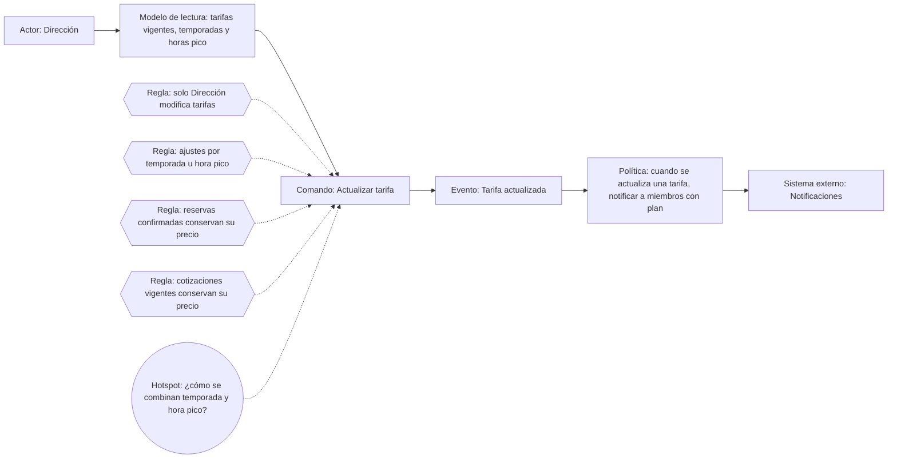
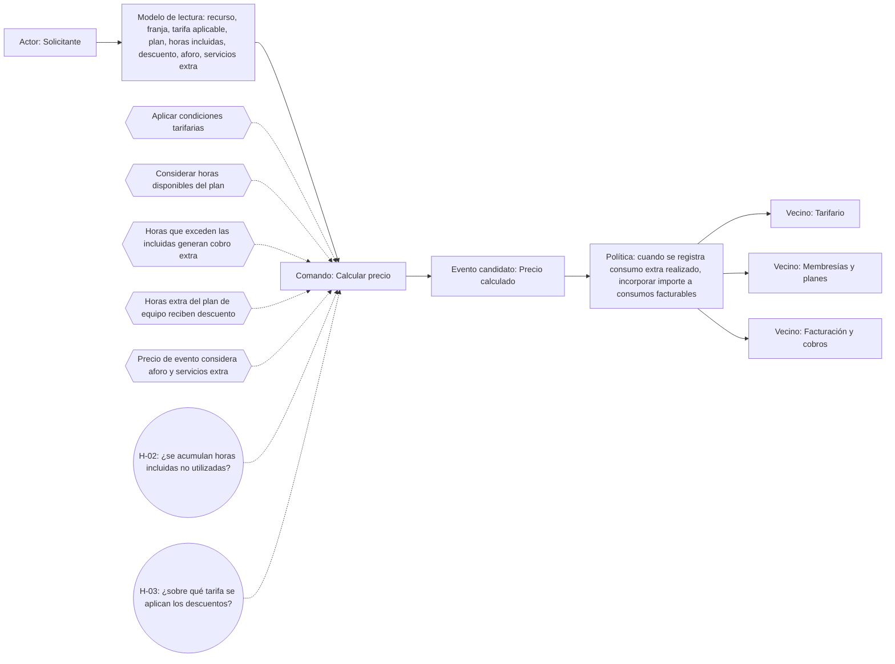
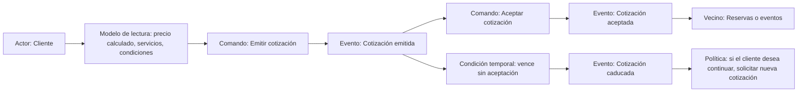

# Event Storming

## 1. Actualización de tarifas (Tarifario)

Dirección consulta las tarifas vigentes, las temporadas y las condiciones de horario pico. Con esa información ejecuta **Actualizar tarifa** y, si se cumplen las reglas, ocurre **Tarifa actualizada**.

### 1.1. Reglas y excepciones

- Solo Dirección puede modificar tarifas: INV-01.
- Dirección puede ajustar tarifas por temporada u hora pico: R-01.
- Las reservas confirmadas conservan su precio aunque cambien las tarifas: INV-02.
- Las cotizaciones vigentes conservan el precio ofrecido: INV-04.

### 1.2. Política y pregunta pendiente

**P-01:** cuando se actualiza una tarifa, entonces se solicita notificar a los miembros con plan. Notificaciones realiza el aviso.

**H-01:** ¿cómo se combinan los ajustes de temporada y hora pico cuando coinciden? Falta definir si se acumulan, si uno reemplaza al otro o si existe una prioridad.

## 2. Cálculo del precio total

Un solicitante necesita conocer el importe de un servicio y ejecuta **Calcular precio**. El modelo de lectura reúne recurso, franja, tarifa aplicable, plan del miembro, horas incluidas, descuento, aforo y servicios extra, según la operación. Tarifario aporta las condiciones tarifarias y Membresías y planes los beneficios del miembro.

### 2.1. Reglas de cálculo

- Aplicar las condiciones tarifarias correspondientes: R-01 y R-02.
- Considerar las horas disponibles del plan antes de determinar las horas adicionales: INV-06.
- Las horas que exceden las incluidas generan cobro extra: INV-06.
- Las horas extra del plan de equipo reciben el descuento del miembro: INV-07.
- El precio del evento considera aforo y servicios adicionales: R-03.

**Precio calculado** es un evento candidato: deberá determinarse si constituye un hecho que necesita registrarse o solo un resultado consultado por otro proceso.

### 2.2. Política de consumos adicionales

**P-02:** cuando se registra un consumo extra efectivamente realizado, entonces se incorpora su importe a los consumos facturables. Esta política requiere consumo real; una consulta de precio no la activa. Las horas extra se incorporan a la facturación mensual: R-04.

Cálculo determina cuánto corresponde cobrar. Facturación y cobros administra la factura y el pago. Tarifario y Membresías aportan los datos necesarios para determinar el importe.

### 2.3. Preguntas pendientes

- **H-02:** ¿las horas incluidas no utilizadas se acumulan para el siguiente período?
- **H-03:** ¿sobre qué tarifa se aplica el descuento del plan: base, ajustada por temporada u hora pico, u otro importe?
- **H-05:** ¿cómo se aplica el posible descuento adicional del 5 % en el plan de equipo?

## 3. Gestión de cotizaciones

El cliente solicita una propuesta para contratar un espacio o realizar un evento. Se consulta el precio calculado, los servicios y las condiciones comerciales. **Emitir cotización** genera la propuesta con su vigencia y produce **Cotización emitida**. No está definido quién tiene a cargo su emisión.

### 3.1. Reglas de la propuesta

- La cotización tiene vigencia limitada.
- Emitir una cotización no reserva automáticamente ningún espacio: INV-03.
- El precio ofrecido se conserva mientras la propuesta permanece vigente: INV-04.
- Aceptar la cotización no equivale a confirmar automáticamente una reserva o un evento: INV-03 y R-05.
- La cotización debe estar vigente para aceptarse: INV-05.

### 3.2. Camino A: aceptación

El cliente ejecuta **Aceptar cotización** mientras la propuesta sigue vigente. Ocurre **Cotización aceptada** y puede continuar la contratación en Reservas y disponibilidad o Agenda de eventos. Para confirmar un evento se requiere depósito y, si es grande, aprobación de Dirección: R-05.

### 3.3. Camino B: caducidad

Si termina el plazo sin aceptación, ocurre **Cotización caducada**. El vencimiento es una condición temporal.

**P-03:** cuando una cotización caduca y el cliente desea continuar, entonces debe solicitar una nueva propuesta económica.

**H-04:** ¿qué sucede si se acepta una cotización vigente, pero el espacio ya no está disponible? La propuesta no garantiza el recurso; ofrecer otra fecha, preparar otra cotización o cerrar la solicitud sigue pendiente.

## 4. Resumen de hotspots

| Código | Pregunta | Proceso |
|---|---|---|
| H-01 | ¿Cómo se combinan temporada y hora pico? | Actualización de tarifas |
| H-02 | ¿Las horas incluidas no usadas se acumulan al siguiente período? | Cálculo |
| H-03 | ¿Sobre qué tarifa se aplican los descuentos del plan? | Cálculo |
| H-04 | ¿Qué pasa si se acepta una cotización y el espacio ya no está disponible? | Cotizaciones |
| H-05 | ¿Cómo se aplica el posible descuento adicional del 5 % en plan de equipo? | Cálculo |

### 4.1. Preguntas complementarias

| Código | Pregunta | Proceso |
|---|---|---|
| H-06 | ¿Cómo se calcula una operación que atraviesa franjas o temporadas? | Cálculo |
| H-07 | ¿Cuál es la fórmula del precio de evento según aforo y servicios extra? | Cálculo |
| H-08 | ¿Qué ocurre en el instante exacto del vencimiento y qué referencia horaria se usa? | Cotizaciones |
| H-09 | ¿Qué sucede con importe y vigencia si cambian fecha, aforo o servicios de una cotización emitida? | Cotizaciones y Cálculo |
| H-10 | ¿Quién puede emitir una cotización? | Cotizaciones |

Estas preguntas deben resolverse con ejemplos antes de fijar las reglas de cálculo y vigencia. Los hotspots de intercambio I-01 a I-06 están en el [context map](05-context-map.md).

## 5. Reglas, políticas e historias relacionadas

| Proceso | Invariantes y reglas | Política | Historia relacionada |
|---|---|---|---|
| Actualización de tarifas | INV-01, INV-02, INV-04 y R-01 | P-01: solicitar aviso a miembros con plan | Actualización de tarifas as-is/to-be y alternativa con reservas confirmadas. |
| Cálculo del precio total | INV-06, INV-07 y R-01 a R-04 | P-02: incorporar el importe del consumo realizado a los consumos facturables | Determinación de importes y colaboración con Facturación. |
| Gestión de cotizaciones | INV-03, INV-04, INV-05 y R-05 | P-03: solicitar una nueva propuesta si caducó y el cliente desea continuar | Aceptación sin disponibilidad. |

Ver el inventario de [reglas e invariantes candidatas](06-reglas-invariantes.md) y las [historias as-is/to-be](04-domain-stories.md).
