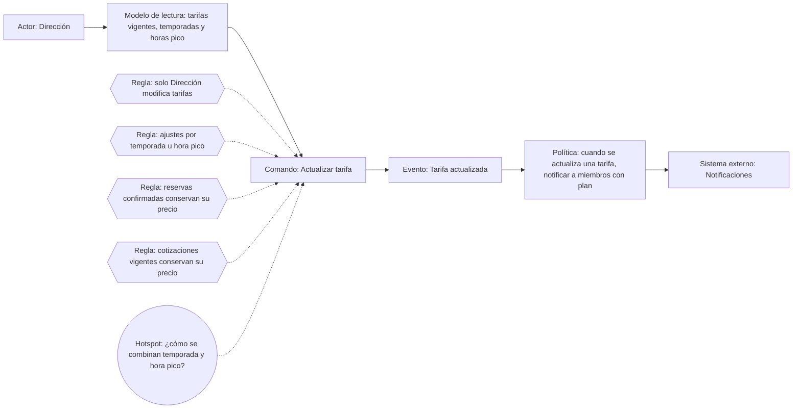
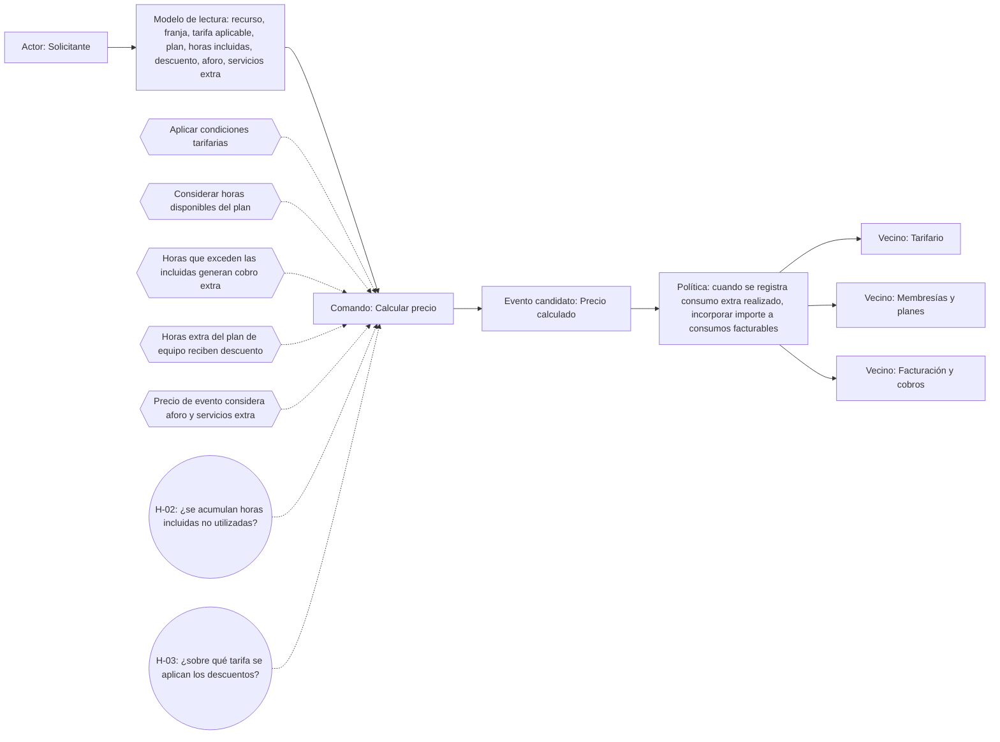
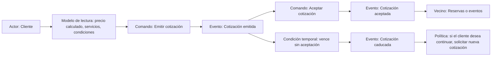

# Event Storming

## 1. Actualización de tarifas (Tarifario)

## 2. Cálculo del precio total

## 3. Gestión de cotizaciones

## 4. Resumen de hotspots

| Código | Pregunta | Proceso |
|---|---|---|
| H-01 | ¿Cómo se combinan temporada y hora pico? | Actualización de tarifas |
| H-02 | ¿Las horas incluidas no usadas se acumulan al siguiente período? | Cálculo |
| H-03 | ¿Sobre qué tarifa se aplican los descuentos del plan? | Cálculo |
| H-04 | ¿Qué pasa si se acepta una cotización y el espacio ya no está disponible? | Cotizaciones |
| H-05 | ¿Cómo se aplica el posible descuento adicional del 5 % en plan de equipo? | Cálculo |