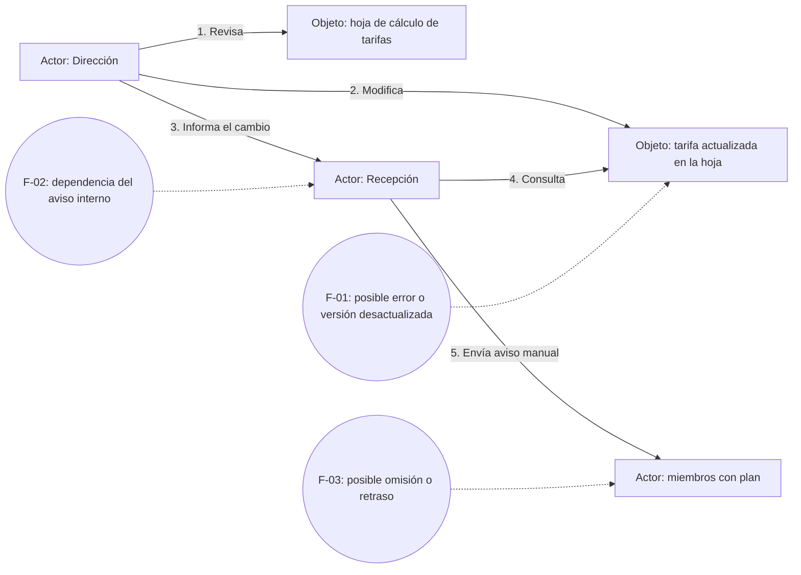
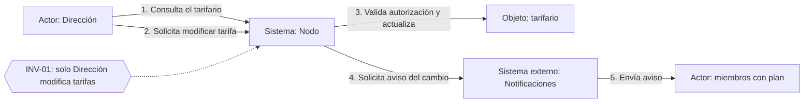
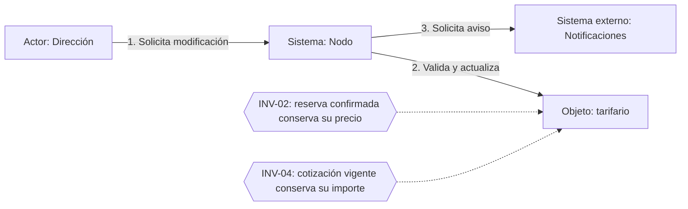
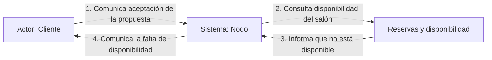

# Domain Storytelling

## 1. Alcance y lectura de las historias

Nodo trabaja con planillas, calendario compartido y avisos manuales. La historia **as-is** describe ese proceso para la actualización de tarifas; la participación de Recepción en ese aviso específico es una hipótesis de la historia. Las historias **to-be** proponen cómo centralizar el tarifario y automatizar la comunicación. Las actividades se numeran y los objetos de trabajo se nombran en cada diagrama.

## 2. Historia 1 as-is: actualización de tarifas

**Objetivo:** cambiar la tarifa de una sala por temporada y comunicarla. **Actores:** Dirección, Recepción y miembros con plan. **Objetos:** hoja de cálculo de tarifas, tarifa actualizada y aviso.

Dirección revisa la planilla y modifica la tarifa. Luego informa a Recepción, que consulta la nueva referencia y comunica el cambio a los miembros. El canal concreto del aviso tarifario está pendiente de definición.

## 3. Historia 1 to-be: actualización mediante el sistema

**Actores y participantes:** Dirección, sistema Nodo, Notificaciones y miembros con plan. **Objetos:** tarifario, solicitud de cambio y aviso de tarifa actualizada.

Tras validar a Dirección y registrar el cambio, el sistema solicita el aviso (P-01). La selección de destinatarios permanece en I-06; la historia no supone que el envío siempre tenga éxito ni define reintentos. El hecho de negocio corresponde a **Tarifa actualizada** en EventStorming.

## 4. Contraste as-is / to-be

| Fricción o aspecto | As-is reconstruido | To-be propuesto | Valor y regla relacionada |
|---|---|---|---|
| F-01: registro y consulta | Planilla actualizada manualmente | Tarifario centralizado en el sistema | Reduce divergencias; conserva la administración en Tarifario. |
| Autorización | Responsabilidad de Dirección en el procedimiento | Validar al responsable antes del cambio | Protege INV-01; un intento no autorizado no produce Tarifa actualizada. |
| F-02: comunicación interna | Dirección debe avisar a Recepción | El cambio registrado origina la solicitud de aviso | Reduce la dependencia del traspaso manual: P-01. |
| F-03: comunicación al miembro | Recepción avisa manualmente | Notificaciones envía el aviso solicitado | Reduce omisiones; identificación de destinatarios pendiente: I-06. |
| Condiciones ya acordadas | Deben respetarse mediante el procedimiento actual | Reservas y Cotizaciones conservan sus importes protegidos | INV-02 e INV-04; no es un recálculo de operaciones anteriores. |

## 5. Historia alternativa: actualización de tarifas con reservas confirmadas

**Situación:** Dirección solicita modificar una tarifa cuando existen reservas confirmadas. **Actores:** Dirección y sistema Nodo. **Objetos:** tarifa y reservas confirmadas.

Dirección solicita al sistema modificar una tarifa. Como parte del comportamiento propuesto, el sistema consulta las reservas confirmadas y actualiza el tarifario, respetando las condiciones comerciales previamente acordadas.

Las reservas confirmadas conservan su precio. Los nuevos cálculos utilizan las tarifas actualizadas, salvo cuando corresponda respetar las condiciones de una cotización vigente. Esta historia complementa el evento **Tarifa actualizada** y muestra que la actualización no debe modificar los importes acordados de las reservas.

## 6. Historia alternativa: aceptación sin disponibilidad

**Situación:** un cliente comunica que acepta una propuesta todavía vigente y el salón ya está ocupado. **Actores y participantes:** Cliente, sistema Nodo y Reservas y disponibilidad. **Objetos:** cotización vigente, solicitud de contratación y resultado de disponibilidad.

Cotizaciones verifica su vigencia (INV-05) y conserva su importe (INV-04). **Cotización aceptada** permite continuar la contratación, pero no produce por sí sola una reserva (INV-03). El cliente comunica su intención de aceptar; el sistema consulta la disponibilidad y, si el salón no está disponible, informa esa situación al cliente. Para un evento también deben cumplirse las condiciones del vecino (R-05).

**Hotspot H-04 / I-03:** ¿qué alternativa debe ofrecerse cuando se acepta una propuesta vigente, pero el salón ya no está disponible? Ofrecer otra fecha, emitir una nueva propuesta o cerrar la solicitud son opciones para discutir en clase.

## 7. Coherencia con EventStorming y fronteras

| Historia | Evento o resultado | Regla / hotspot | Frontera revelada |
|---|---|---|---|
| Actualización mediante el sistema | Tarifa actualizada; solicitud de aviso | INV-01, P-01, I-06 | Tarifario administra; Notificaciones comunica. |
| Actualización con reservas confirmadas | Tarifa actualizada sin cambiar importes protegidos | INV-02, INV-04 | Tarifario cambia referencias; Reservas y Cotizaciones mantienen sus acuerdos. |
| Aceptación sin disponibilidad | Cotización aceptada; disponibilidad negativa del vecino | INV-03, INV-05, H-04 | Cotizaciones gestiona aceptación; Reservas decide ocupación. |

Estas historias muestran qué conviene automatizar y qué permanece como decisión comercial. Ver [EventStorming](03-event-storming.md), [context map](05-context-map.md) y [reglas e invariantes](06-reglas-invariantes.md).
