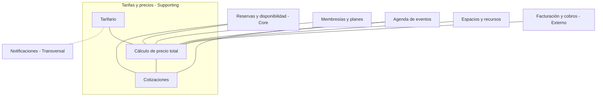

# Context map

- **Propios:** Reservas y disponibilidad (Core), Membresías y planes, Agenda de eventos, Espacios y recursos y los tres contextos de nuestra área.
- **Externo:** Facturación y cobros (fuera del alcance de implementación del equipo; forma parte del negocio Nodo).
- **Transversal:** Notificaciones.

## Relaciones y datos que cruzan

| Relación | ¿Qué se solicita? | ¿Qué se entrega o comparte? |
|---|---|---|
| L-01 Tarifario — Cálculo | Tarifas y condiciones vigentes | Tarifas base y ajustes aplicables |
| L-02 Cálculo — Cotizaciones | Importe de los servicios solicitados | Precio calculado para la propuesta |
| L-03 Membresías y planes — Cálculo | Plan, horas incluidas y descuentos | Beneficios para determinar el precio; no se definió respuesta hacia Membresías |
| L-04 Espacios y recursos — Cálculo | Tipo de recurso y capacidad | Características necesarias para calcular el importe |
| L-05 Reservas — Cálculo | Recurso y franja solicitada | Precio calculado para la reserva |
| L-06 Reservas — Cotizaciones | Disponibilidad del recurso solicitado | Datos de la cotización aceptada para continuar la contratación |
| L-07 Eventos — Cálculo | Aforo y servicios adicionales | Importe calculado para el evento |
| L-08 Eventos — Cotizaciones | Datos del evento y sus condiciones | Propuesta económica y aceptación |
| L-09 Facturación — Cálculo | Importes de consumos adicionales facturables | Importe de horas extra y otros consumos calculados |
| T-01 Tarifario — Notificaciones | Comunicación de cambios tarifarios | Solicitud de aviso a miembros con plan |

## Por vecino: qué le pido / qué le entrego

| Vecino | Le pido | Le entrego |
|---|---|---|
| Reservas y disponibilidad | Disponibilidad del recurso; recurso y franja solicitada | Precio calculado para la reserva; datos de la cotización aceptada |
| Membresías y planes | Plan, horas incluidas, descuentos | Nada definido todavía |
| Agenda de eventos | Datos del evento, aforo, servicios extra | Importe del evento; propuesta económica y aceptación |
| Espacios y recursos | Tipo de recurso y capacidad | Nada (solo consume) |
| Facturación y cobros (externo) | — | Importes facturables (horas extra y consumos) |
| Notificaciones (transversal) | Envío de avisos | Solicitud de aviso por tarifa actualizada |

## Hotspots de integración

| Código | Relación | Pregunta pendiente |
|---|---|---|
| I-01 | Tarifario — Cálculo | ¿Cómo identificar la tarifa aplicable sin afectar precios previamente acordados? |
| I-02 | Membresías — Cálculo | ¿Cómo consultar horas incluidas disponibles y descuentos actualizados? |
| I-03 | Cotizaciones — Reservas | ¿Qué sucede si se acepta una cotización vigente pero el recurso ya no está disponible? |
| I-04 | Eventos — Cálculo | ¿Cómo se comunicarán el aforo y los importes de servicios extra? |
| I-05 | Cálculo — Facturación | ¿Cómo evitar que un mismo consumo adicional se facture dos veces? |
| I-06 | Tarifario — Notificaciones | ¿Cómo identificar a los miembros que deben recibir el aviso? |